# 🛰️ AgroTech Enterprise | Cloud Edge Observability & Land M&A Management

> **Plataforma corporativa de monitoramento distribuído em nuvem, telemetria de borda e governança financeira de ativos rurais.** Um sistema de missão crítica desenvolvido para aliar observabilidade de infraestrutura (*DevOps*), processamento assíncrono de APIs REST e inteligência imobiliária para o agronegócio de alta escala.

---

## 📑 Sumário
1. [Resumo Executivo e Contexto Operacional](#1-resumo-executivo-e-contexto-operacional)
2. [As 5 Métricas Chave de Infraestrutura (DevOps)](#2-as-5-métricas-chave-de-infraestrutura-devops)
3. [Arquitetura de Software e Mapeamento Funcional](#3-arquitetura-de-software-e-mapeamento-funcional)
4. [Avaliação de Resultados e Tomada de Decisão](#4-avaliação-de-resultados-e-tomada-de-decisão)
5. [Galeria Operacional do Sistema (Screenshots 1 a 12)](#5-galeria-operacional-do-sistema-screenshots-1-a-12)
6. [Guia de Instalação e Execução Local](#6-guia-de-instalação-e-execução-local)
7. [Referências Bibliográficas](#7-referências-bibliográficas)

---

## 1. Resumo Executivo e Contexto Operacional
Atuando como uma solução integrada de missão crítica, a plataforma simula o gerenciamento centralizado de uma infraestrutura em nuvem e nós de borda (*Edge Computing*) distribuídos em polos agrícolas de alto rendimento (São Paulo e Centro-Oeste). O sistema mitiga latências de satélite, gerencia buffers locais resilientes e provê um painel executivo de governança imobiliária para fundos de investimento e diretores.

---

## 2. As 5 Métricas Chave de Infraestrutura (DevOps)
Para assegurar a performance, estabilidade e confiabilidade da aplicação em produção, a plataforma monitora continuamente os seguintes indicadores vitais:
* **Número de Requisições por Segundo (Throughput):** Mensura o volume de tráfego ativo e a carga sobre os servidores em nuvem.
* **Tempo de Resposta da Aplicação (Latency - ms):** Avalia a agilidade de processamento e resposta às solicitações dos usuários.
* **Uso da CPU (%):** Monitora a demanda de processamento computacional, evitando estrangulamentos de hardware.
* **Taxa de Erros (%):** Quantifica o percentual de falhas transacionais em relação ao tráfego total.
* **Disponibilidade (% / Uptime):** Afere o tempo em que o sistema permaneceu acessível, garantindo o cumprimento de SLAs rigorosos.

---

## 3. Arquitetura de Software e Mapeamento Funcional
Construída em **Python** com o framework reativo **Dash** e estilização avançada orientada ao padrão *Dark Ops / Enterprise*, a aplicação divide-se em duas abas estratégicas:

* **Aba 1: NOC & Telemetria de Borda (`📡`)**
  * *O que faz:* Processa dados em tempo real via **Open-Meteo REST API** e simula o estado operacional de servidores locais.
  * *Componentes visuais:* Gráficos de barras (Carga MQTT/Sensores IoT), linhas múltiplas (Latência de rede vs. Uso de CPU), área (Largura de banda de upstream via satélite), além de logs dinâmicos de kernel (*Systemd*), status de VPN (*WireGuard*) e qualidade de sinal (*LoRaWAN RSSI*).
* **Aba 2: Portfólio de Terras, M&A e Cadastro (`💼`)**
  * *O que faz:* Centraliza a governança imobiliária e o cálculo patrimonial de ativos rurais.
  * *Componentes visuais:* Cards executivos de **AUM (Assets Under Management)**, projeção de lucro líquido por cultura (Café, Soja, Pecuária, Cana), formulários dinâmicos de cadastro para novas aquisições (M&A) e tabelas consolidadas de ROI e ganho de capital.

---

## 4. Avaliação de Resultados e Tomada de Decisão

1. **Como essas métricas contribuem para a análise de desempenho da aplicação?**
   Fornecem uma visão holística da saúde sistêmica. Indicadores de throughput e CPU avaliam a pressão sobre a infraestrutura, enquanto latência, taxa de erros e disponibilidade traduzem diretamente a experiência do usuário final e a integridade do código em produção.
2. **Que tipo de informação o dashboard permite compreender com mais clareza?**
   O painel traduz dados complexos em correlações visuais intuitivas, evidenciando o impacto imediato de picos de tráfego sobre os recursos computacionais, padrões de sazonalidade operacional e o cruzamento entre métricas técnicas e indicadores financeiros de negócio.
3. **Como a criação de dashboards pode ajudar um time DevOps na tomada de decisões?**
   Atua como a ferramenta central para operações orientadas a dados (*Data-Driven*), auxiliando no planejamento de capacidade (*capacity planning*), na redução do tempo médio de mitigação de falhas (*MTTR*) e no alinhamento estratégico entre equipes técnicas e a alta gestão.

---

## 5. Galeria Operacional do Sistema (Screenshots 1 a 12)

Abaixo estão registradas as 12 visualizações operacionais extraídas diretamente do ambiente de execução, documentando os estados de telemetria, navegação em abas, matrizes comparativas e o módulo de gestão financeira de ativos:

| Visão Geral do Sistema (NOC) | Telemetria de Borda - São Paulo |
| :---: | :---: |
| 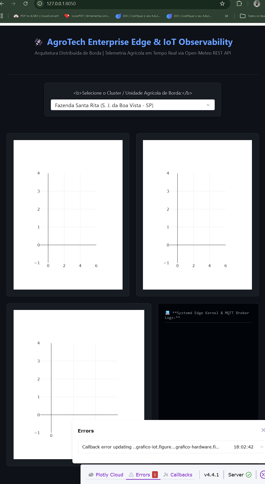 | 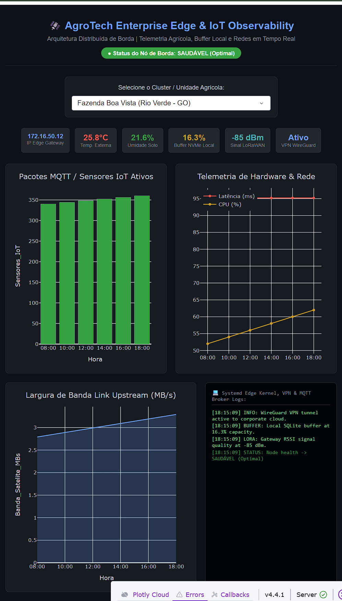 |

| Métricas e Gráficos de Hardware | Monitoramento de Largura de Banda |
| :---: | :---: |
| 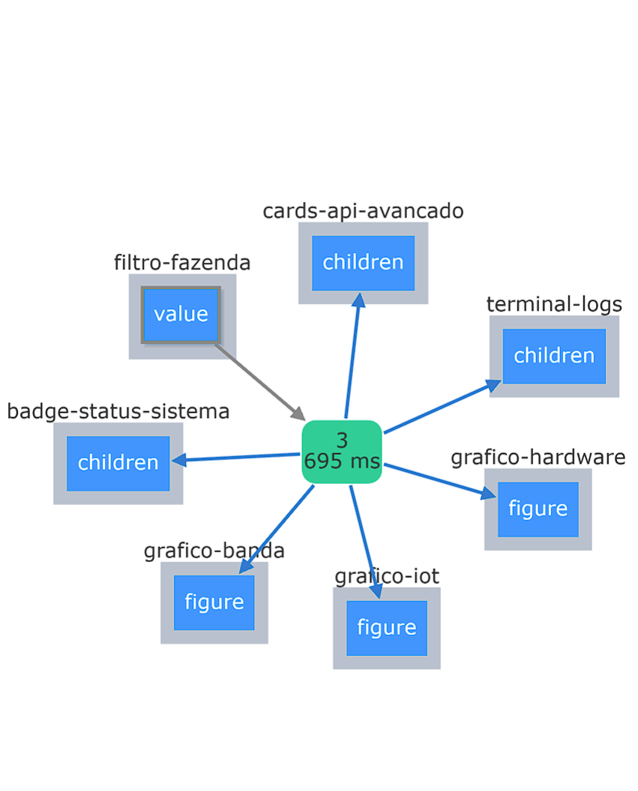 | 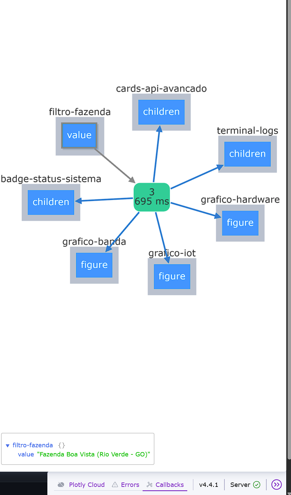 |

| Logs do Kernel e WireGuard VPN | Seleção de Cluster Regional (SP) |
| :---: | :---: |
| 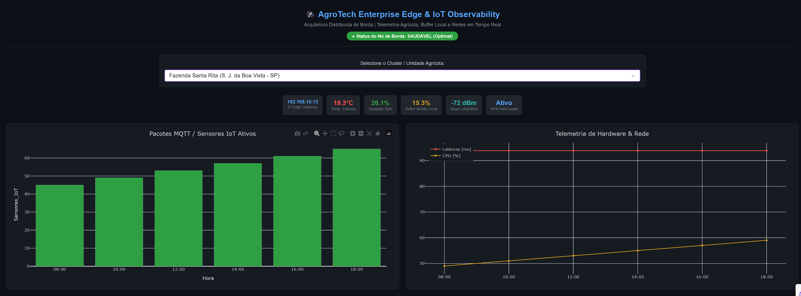 | 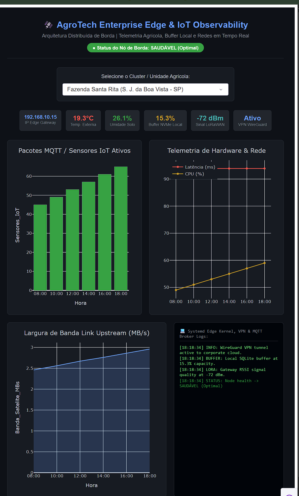 |

| Cluster Centro-Oeste (Rio Verde - GO) | Cluster Extensivo (Sorriso - MT) |
| :---: | :---: |
| 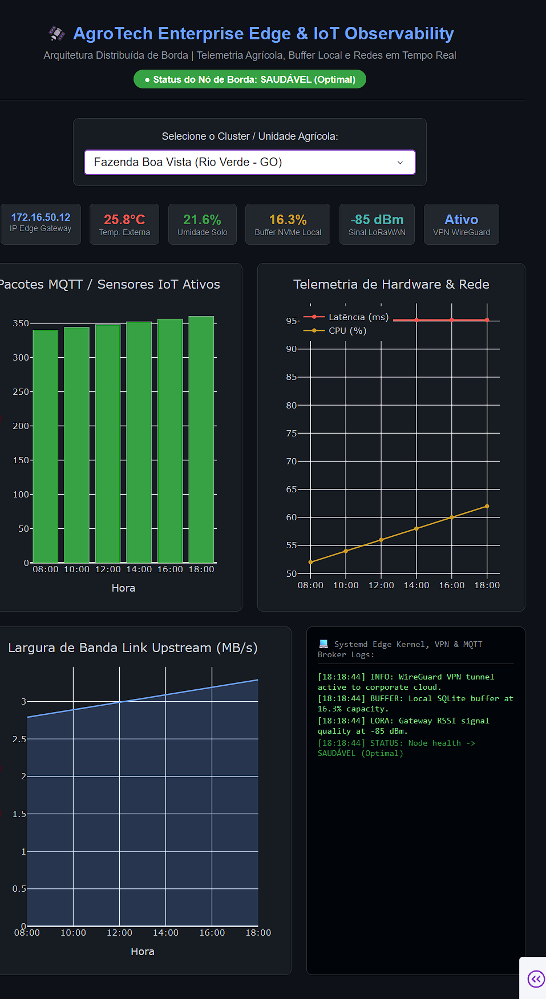 | 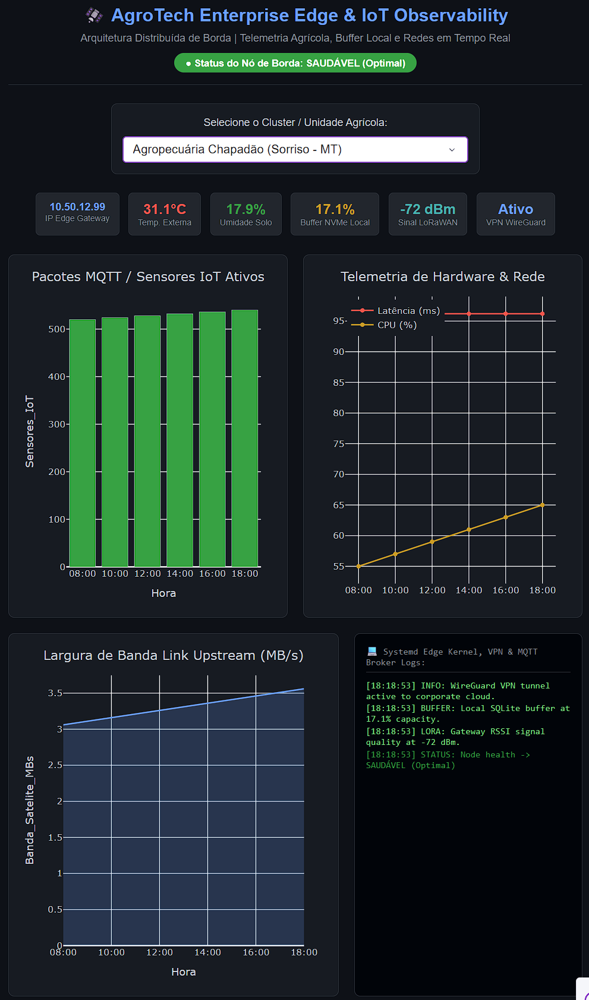 |

| Visão Detalhada de Produtividade | Matriz de Comparação Multirregional |
| :---: | :---: |
| 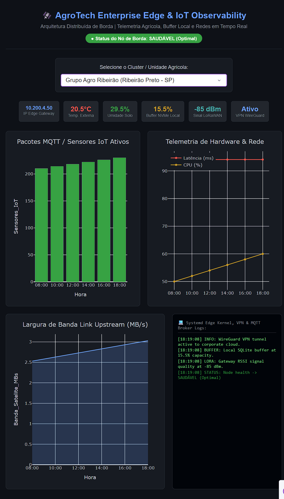 | 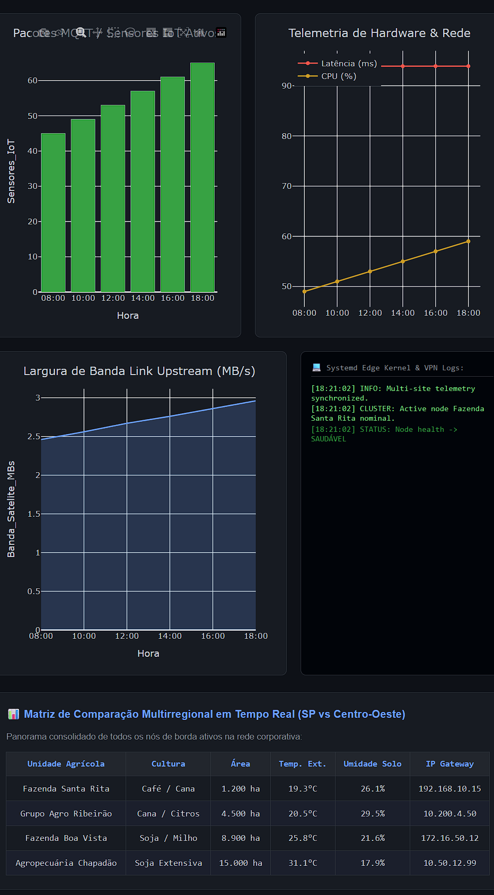 |

| Aba de Portfólio de Terras e M&A | Extrato Consolidado de Ativos |
| :---: | :---: |
| 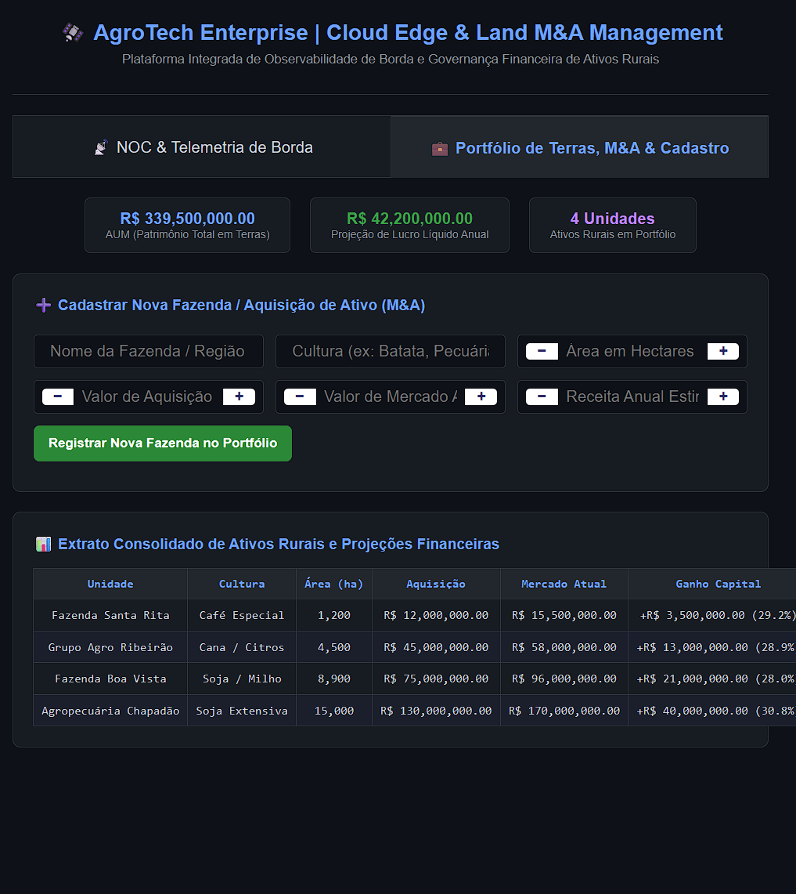 | 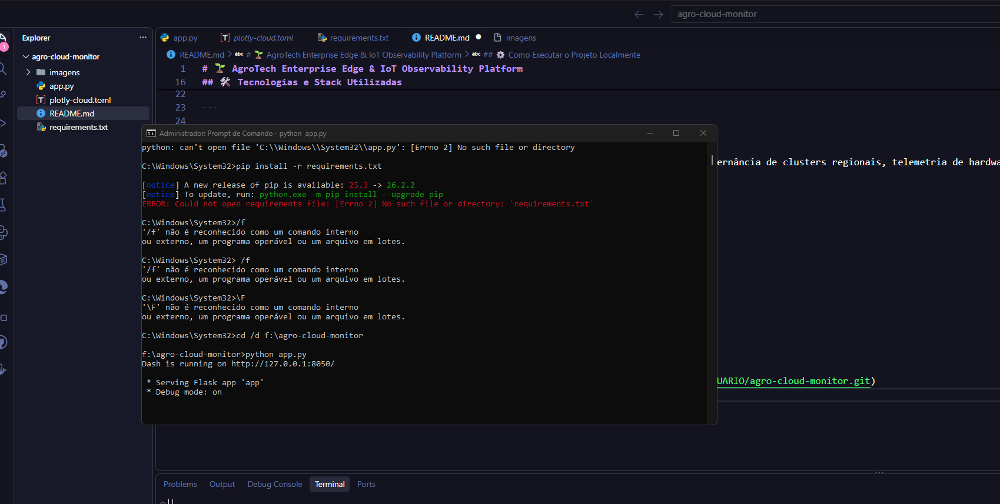 |

---

## 6. Guia de Instalação e Execução Local

1. Clone o repositório em sua máquina:
   ```bash
   git clone [https://github.com/andersonsilvanto/agro-cloud-monitor](https://github.com/andersonsilvanto/agro-cloud-monitor)
   cd agro-cloud-monitor